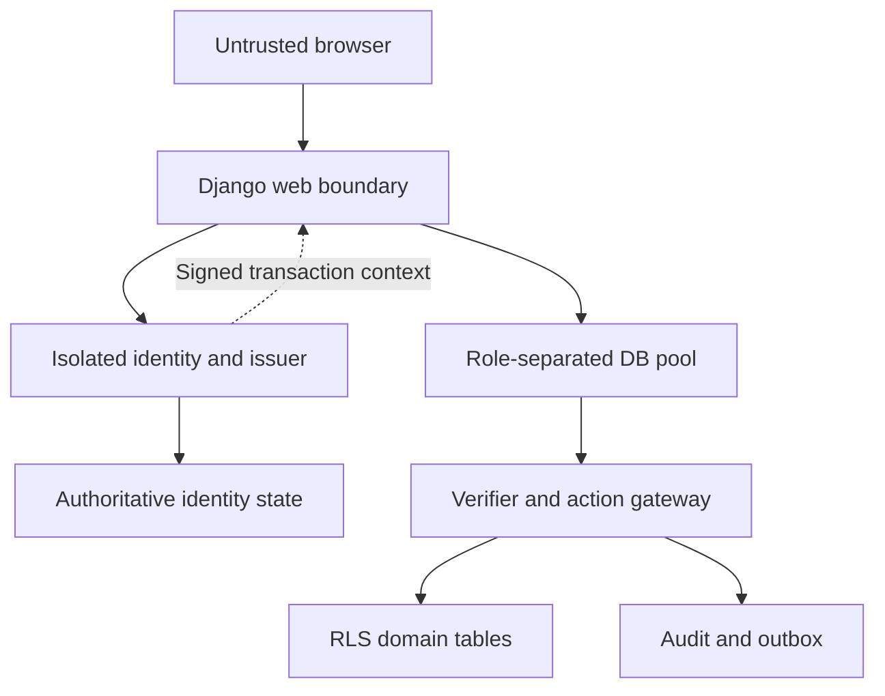

# Trust boundaries and threat model

**DESIGN_ONLY / PROPOSED_CONTRACTS** — see [authority and source inventory](README.md).

Assets: private store data; owner/delegation authority; session and MFA evidence; signing keys; invitation secrets; transaction scope; durable audit and outbox integrity. Adversaries include unauthenticated web clients, authenticated low-privilege members, another tenant, stolen invitation/session holders, SQL injection under runtime, malicious/compromised web workers, compromised delivery workers, and privileged insiders. DB administrator and issuer compromise are explicit trust failures, not threats RLS alone solves.

Every arrow crosses an authenticated/authorized interface; proximity or network reachability is not authorization. W never receives signing keys. The browser never receives database contexts. Identity-state access is separate from tenant-data ORM access, avoiding a requirement for an untrusted context to discover identity. Context scope selectors are untrusted until checked by I and DB authorization.

| ID / boundary | Attack and effect | Proposed control / test IDs | Residual trust |
|---|---|---|---|
| TM-01 browser → Django | CSRF/login CSRF, cookie fixation, stolen bearer, XSS | HTTPS-only host-scoped session cookie; CSRF on login/unsafe methods; rotate at login/step-up; no state-changing GET; ID-01..04 | CSRF does not stop XSS; stolen live sessions remain usable until revoked |
| TM-02 identity → owner | Email or store slug treated as owner proof, recycled identifier, automatic account linking | Immutable principal mapping, verified account/channel and separate owner onboarding approval; no email-only linking; ID-05 | Contact proof is not legal-business/domain proof |
| TM-03 web → issuer | Caller supplies arbitrary principal, role, cap, MFA age or tenant | Issuer derives actor from authoritative session, checks scope and action; accepts request selectors only; ID-06, CTX-01 | Compromised web process can use sessions it legitimately observes; isolated issuer limits, not eliminates, impact |
| TM-04 issuer/key | Key theft, permissive algorithm, retired key reuse | Explicit version/kid/purpose/audience; key states, shortest lifetimes, no fallback; CTX-02..05 | Issuer can mint authority; DB admin can read HMAC key/change policies |
| TM-05 arbitrary SQL runtime | Forge GUC, SET ROLE, call privileged function, reuse signed payload for another action | Signature + fresh authoritative epochs + action/digest binding; no write ACL, narrow action gateway, nonowner roles; DB-01..04 | A valid read context permits reads within its authorized scope; does not cure SQL injection |
| TM-06 pool boundary | Prior scope leaks; context outside transaction; savepoint restores older value | Explicit outer transaction; bind actual tx/PID/db generation; single context per transaction; discard on ambiguous cleanup; POOL-01..07 | Pool version/configuration must be exercised, not inferred |
| TM-07 concurrent auth/revoke | Check-then-use escalation, zero-grant pending invitation survives | Same critical section for validation and mutation; actor/session guard + Store guard; race 01..08 and AUTH-RACE | Coarse locks limit throughput; bounded in-flight requests precede revocation commit |
| TM-08 invitation | Token theft, target substitution, reused old invitation after revoke | Digest-only storage; verified immutable target binding; expiry and terminal states; current inviter authority; ONB-02..06 | Delivery channel compromise; no email string used as identity |
| TM-09 output/logging | Token/context/PII leakage through query logs, error messages or outbox | Parameter redaction, allowlisted security metadata, generic scoped error, encrypted expiring delivery payload; AUD-01..04 | Admin/host compromise and exported backups need separate controls |
| TM-10 infrastructure | DB owner bypass, superuser, compromised provisioner/worker | Separate credentials/pools, NOINHERIT/NOBYPASSRLS, fixed search_path, no PUBLIC EXECUTE; DB-01..03 | Owner can change RLS; backups/admin access not constrained by RLS |
| TM-11 availability | Signer/key store outage, lock exhaustion, brute force | Fail closed, rate/size limits, short deadlines, bounded retries, no provider call inside business transaction; CTX-06, POOL-06 | Denial of service is possible; availability cannot justify unsigned fallback |

No claim of protection against complete application-host, issuer or DB administrator compromise. Distinguish SQL injection limited to runtime credentials from web RCE able to steal session handles. Neither JWT-style signing nor MFA alone prevents confused-deputy authorization. Background workers must use task-scoped service authorization, not replay user contexts.

Assumptions to validate: authoritative identity and revocation guard state can participate in the chosen PostgreSQL locking model; issuer transport authenticates the requesting workload; DB generation changes on restore/failover; no path allows domain SQL before context; all mutation routes use the same gate/lock order. If these assumptions fail, the design is BLOCKED rather than silently weakened.
